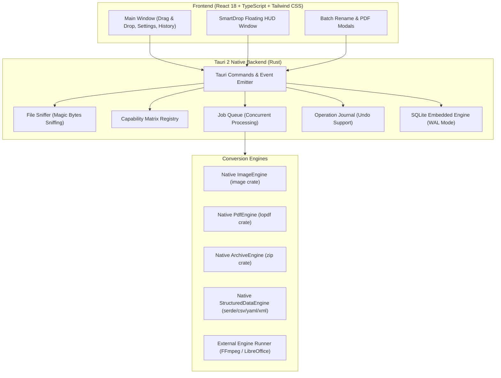

# MorphDrop — Universal File Converter & SmartDrop

MorphDrop is a cross-platform desktop application combining a universal file converter with an always-on-top, draggable floating utility (**SmartDrop**). It makes desktop file conversions and batch transformations effortless, fast, and 100% private.

---

## 🌟 Highlights & Key Features

- **Universal Conversion Engine**:
  - **Images**: PNG, JPEG, WebP, BMP, TIFF, GIF, ICO, AVIF with quality compression and proportional resizing.
  - **Documents & PDFs**: Images to PDF combining, PDF merging, and multi-page splitting.
  - **Archives**: Fast ZIP archive compression and extraction with path-traversal & decompression-bomb safeguards.
  - **Structured Data**: Lossless and tabular conversions between JSON, CSV, TSV, YAML, and XML.
  - **Optional Media Transcoding**: Discovers system FFmpeg for video/audio conversions and audio track extraction.
  - **Optional Office Documents**: Discovers LibreOffice headless for DOCX, PPTX, XLSX, and ODT to PDF conversions.
- **SmartDrop (Floating HUD Utility)**:
  - Accessible via global shortcut (`⌘ + Shift + Space` on macOS, `Ctrl + Shift + Space` on Windows).
  - Always-on-top, compact glass HUD window for dragging files directly from Finder / File Explorer.
  - Contextual quick actions: *Make Smaller*, *Bundle ZIP*, *Make Compatible*, *Reveal in Folder*.
  - Dismiss immediately with `Esc` or click outside.
- **Batch Renamer with Undo Journal**:
  - Custom rules: Prefix, Suffix, Find & Replace, Numbering (`_001`, `_002`), Case conversions (lowercase, UPPERCASE, Title Case, snake_case, kebab-case), Date stamping (`YYYY-MM-DD`).
  - Clean invalid characters and whitespace automatically.
  - Live preview table before making changes.
  - Complete operation journal with single-click **Undo** to restore original filenames.
- **100% Offline & Private**:
  - No files are ever uploaded to cloud services.
  - Original files are preserved by default.
  - Atomic temporary-file creation ensures no partial or corrupted outputs exist.
- **Local Persistence**:
  - SQLite database stores past conversion history with instant folder reveal and path copying.

---

## 🏗️ Architecture



---

## 💻 Tech Stack

- **Desktop Framework**: [Tauri 2](https://v2.tauri.app/) (Rust native core)
- **Frontend**: React 18, TypeScript, Tailwind CSS, Lucide Icons, Vite 6
- **Native Backend**:
  - `image` (0.25) — pure Rust high-performance image decoder & encoder
  - `lopdf` (0.33) — native PDF manipulation, object stream parsing, and page extraction
  - `zip` (2.6) — zip compression and safe decompression
  - `rusqlite` (0.31) — embedded SQLite database with WAL mode
  - `csv`, `serde_json`, `serde_yaml`, `quick-xml` — structured data transformations
  - `tauri-plugin-global-shortcut` (v2) — OS-level shortcut registration

---

## 🚀 Getting Started

### Prerequisites

- **Node.js**: v18+ (tested with v20/v25)
- **Rust**: stable toolchain (`rustup default stable`)

### Development Setup

1. **Clone repository and install frontend dependencies:**
   ```bash
   npm install
   ```

2. **Verify tests:**
   ```bash
   # Run all 29 backend tests
   cd src-tauri && cargo test && cd ..

   # Run frontend typecheck and build
   npm run build
   ```

3. **Run desktop application in development mode:**
   ```bash
   npx @tauri-apps/cli dev
   ```

---

## 📦 Building for Production

### macOS (Apple Silicon & Intel Universal)

```bash
# Build production bundle (.dmg and .app)
npx @tauri-apps/cli build
```
Output DMG bundle location: `src-tauri/target/release/bundle/dmg/MorphDrop_0.1.0_aarch64.dmg`.

#### Code Signing & Notarization on macOS
Set the following environment variables before running build:
- `APPLE_SIGNING_IDENTITY="Developer ID Application: Your Name (TEAM_ID)"`
- `APPLE_ID="your-email@domain.com"`
- `APPLE_PASSWORD="app-specific-password"`
- `APPLE_TEAM_ID="TEAM_ID"`

### Windows 10 / 11 (x64)

```powershell
# Build NSIS installer (.exe) and MSI bundle
npx @tauri-apps/cli build
```
Output installer location: `src-tauri\target\release\bundle\nsis\MorphDrop_0.1.0_x64-setup.exe`.

#### Code Signing on Windows
Configure `tauri.conf.json` under `bundle > windows > certificateThumbprint` or sign with `signtool.exe`:
```powershell
signtool sign /tr http://timestamp.digicert.com /td sha256 /fd sha256 /a "path\to\MorphDrop.exe"
```

---

## 🔍 External Dependencies (Optional)

MorphDrop is designed so that **no external binaries are required** for core workflows (Images, PDFs, ZIPs, Data, Batch Renaming).

For extended capabilities, MorphDrop detects system CLIs automatically:
- **FFmpeg**: Required for Video/Audio conversions.
  - macOS: `brew install ffmpeg`
  - Windows: `winget install Gyan.FFmpeg`
- **LibreOffice Headless**: Required for Office document conversions to PDF.
  - macOS: `brew install --cask libreoffice`
  - Windows: `winget install TheDocumentFoundation.LibreOffice`
- **7-Zip**: Extended archive handling.
  - macOS: `brew install sevenzip`
  - Windows: `winget install 7zip.7zip`

Status and installation guides are live in **Settings > Conversion Engines & Dependencies**.

---

## 🛡️ Security & Reliability

1. **No Cloud Uploads**: Conversions happen entirely in-process on the local CPU.
2. **Decompression Bomb Protection**: ZIP decompression imposes a 1 GB maximum expansion ceiling.
3. **Path Traversal Shield**: All archive entries are verified against canonical target directory boundaries to prevent `../` directory escapes.
4. **Collision Avoidance**: If `output.png` exists, the engine safely generates `output_1.png` rather than destructively overwriting files.
5. **No Shell Injections**: External binary invocations avoid invoking shell processes (`sh -c` or `cmd.exe`) and pass strict argument vectors directly through `std::process::Command`.
